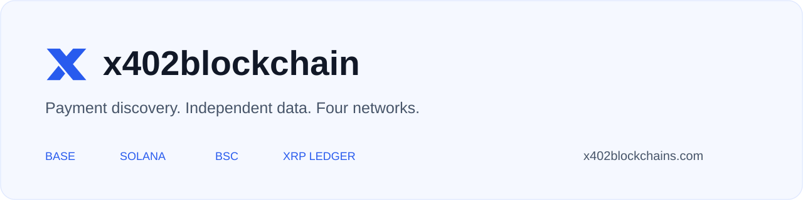

<a href="https://x402blockchains.com/">Website</a> · <a href="https://x402blockchains.com/ai-agents-apps/">AI Agents & Apps</a> · <a href="https://x402blockchains.com/articles/">Articles</a> · <a href="https://x.com/x402blockchains">X</a>

# X402blockchains

Discover x402 projects, AI agents, apps and facilitators across Base, Solana and BNB Chain. Explore project profiles and payment activity on the website.

This public repository contains community resources and selected frontend material. The production backend, data collection implementation, schemas and operational configuration are not distributed here. Older frontend/build files are retained for reference and do not constitute a complete runnable platform.

## Submit your project

- [Apply through the public registry](https://github.com/X402blockchains/x402-registry)
- [Open a project or facilitator application](https://github.com/X402blockchains/x402blockchain/issues/new/choose)
- [Read the listing guide](docs/LISTING-GUIDE.md)

Provide an official website, working logo, documentation, public support, ownership evidence and supported payment networks. Paid services should include a successful transaction and matching delivery evidence. Never post credentials or usable payment authorizations. Approval and website publication are separate; listing is not a security audit or a guarantee of performance.

## Public resources

| Resource | Location |
|---|---|
| Public facilitator information | [facilitators/](facilitators/) |
| Listing metadata and proposals | [listings/](listings/) |
| Articles | [news/](news/) |
| Brand assets | [branding/](branding/) |
| Public frontend material | [public-website/](public-website/) |

See [Contributing](CONTRIBUTING.md) and [Security](SECURITY.md). Public visibility does not grant a new open-source licence; existing notices and applicable rights remain in place.
